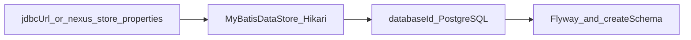

# PostgreSQL 支持方案

工程版本是 `3.76.1-02`，在基线构建号上递增一位。代码基线是 tag `release-3.76.1-01`（提交 `8fc4479cf8`，2025-01-23），也就是最后一条 Nexus Repository OSS 线。

目标是让从这份 EPL 源码编出来的发行物可以把 datastore 接到外部 PostgreSQL。H2 继续作为默认库。本文只记录方案，不改数据库实现。

## 已经在源码里的部分

公开树里已经有 PostgreSQL 方言，缺的是把它打进可运行发行物，并在空库上验证 schema。

- `components/nexus-datastore-mybatis/src/main/java/org/sonatype/nexus/datastore/mybatis/MyBatisDataStore.java` 在 JDBC URL 以 `jdbc:postgresql` 开头时设置 `org.postgresql.Driver`，并写入 pgjdbc 的 `dataSource.stringtype=unspecified`。
- 同一类通过 `VendorDatabaseIdProvider` 选择 MyBatis 的 `databaseId`。至少 18 个 DAO XML 带有 `databaseId="PostgreSQL"`。带 `databaseId="H2"` 的文件同时有 PostgreSQL 语句。
- `components/nexus-datastore-mybatis/src/main/java/org/sonatype/nexus/datastore/mybatis/PlaceholderTypes.java` 为 H2 和 PostgreSQL 提供 UUID、JSON/JSONB、BYTEA 对照。
- `components/nexus-quartz/src/main/java/org/sonatype/nexus/quartz/internal/JobStoreJdbcProvider.java` 在数据库产品名为 PostgreSQL 时使用 `PostgreSQLDelegate`。
- `components/nexus-datastore-mybatis/pom.xml` 依赖 `org.postgresql:postgresql`。原先是 optional，现已去掉该标记，驱动因此随 Karaf feature 进入发行物。
- `buildsupport/db/pom.xml` 和 Pax Exam（`components/nexus-pax-exam`）里已有测试用的 PostgreSQL JDBC URL 钩子。

配置入口已经存在，不需要新开一套：

- 系统属性 `nexus.datastore.nexus.jdbcUrl`
- 环境变量 `NEXUS_DATASTORE_NEXUS_JDBCURL`
- 工作目录下的 `etc/fabric/nexus-store.properties`，其中 `jdbcUrl` 以 `jdbc:postgresql` 开头

## 已验证

驱动已进入运行时。去掉 `<optional>` 后，`org.postgresql:postgresql` 进入 `nexus-base-feature` 的 feature.xml，发行物里有 `system/org/postgresql/postgresql/42.7.2/postgresql-42.7.2.jar`。

空库启动验证通过（PostgreSQL 16，`docker/docker-compose.yml`）：

- `Loaded 'nexus' data store configuration from external JDBC settings`，`MyBatis databaseId: PostgreSQL`，未回退到 H2
- Flyway 与各 DAO 的 `createSchema` 建出 55 张表；`flyway_schema_history` 共 53 条，`success = false` 的 0 条，`Completed migration from v1 to v2.10`
- 没有发现只有 H2 路径而缺 PostgreSQL 语句的情况，因此未新增任何 SQL
- raw 仓库建库、上传、下载通过，数据落在 `raw_asset` 与 `raw_asset_blob`
- 启动日志 ERROR 为 0；88 条 WARN 与 H2 下完全一致，无 PostgreSQL 引入项
- H2 回归通过：不配 JDBC URL 时仍为 `databaseId: H2`，去掉 optional 未影响默认路径

另有两处与数据库无关的配套修复：

- `MyBatisDataStore.openPool()` 在 PostgreSQL 分支下把线程上下文 ClassLoader 切到本 bundle，Hikari 才能在 OSGi 下找到驱动
- `configureHikari` 里 `maximumPoolSize` 改为写入字符串。`HikariConfig(Properties)` 走 bean 反射，只接受 `String`，原先传 `Integer` 不生效

Maven 与 APT 的读写尚未验证，见下面第 4 步。

## 实现顺序

1. 已完成。把 PostgreSQL JDBC 驱动打进 datastore 的 Karaf feature，使 `assemblies/nexus-base-template` 的运行时 classpath 上有 `org.postgresql.Driver`。H2 驱动保留。
2. 已完成。用上面三个已有入口连接外部库。不改默认值：未配置 JDBC URL 时仍使用嵌入式 H2。
3. 已完成。在空的 PostgreSQL 上启动一次，确认 Flyway 与 `createSchema` 能建出 datastore 使用的表。实测无需补任何语句。
4. 待做。用现有 Pax Exam 与 `buildsupport/db` 的测试钩子，对 Maven、Raw、APT 做一轮读写。这三条是本树里的格式。目前只手工验证过 Raw。
5. 已完成。连接池沿用 `MyBatisDataStore` 里已有的 PostgreSQL 分支，包括 `stringtype=unspecified` 和 content store 的默认 `maximumPoolSize`。

## 不做的事

- `components/nexus-core/src/main/java/org/sonatype/nexus/internal/datastore/task/H2BackupTask.java` 只对 H2 执行 `BACKUP TO`。PostgreSQL 的备份留给数据库自己的工具，不把这条任务改成通用备份。
- 已有 H2 数据迁到 PostgreSQL 是后续阶段。不使用 Community Edition 里未公开的迁移工具。
- `isPostgresql` 为真时才会打开的复制等 Pro 能力保持关闭。
- 不加入本树没有的格式插件，也不从 Community Edition 或 Pro 安装包反编译驱动、方言或迁移代码。
